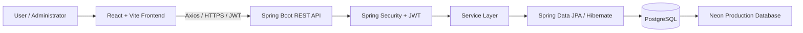

# WealthWise --- Financial Habit Builder & Wealth Growth Tracker

A full-stack personal finance and financial-wellness application
designed to help students and young professionals manage day-to-day
money, build better financial habits, track savings goals, and
understand their overall net worth.

```{=html}
<p align="center">
```
`<strong>`{=html}React + Spring Boot +
PostgreSQL`</strong>`{=html}`<br/>`{=html} `<em>`{=html}Manual-first
personal finance management with role-based administration`</em>`{=html}
```{=html}
</p>
```
## Live Application

-   **Frontend:** https://wealthwise-frontend-ept5.onrender.com
-   **Backend:** https://wealthwise-backend-ccfr.onrender.com
-   **GitHub:** https://github.com/Sandeep8217/financial-habit-builder

> The backend may take some time to respond after an idle period when
> running on a free hosting instance.

## Project Overview

WealthWise brings essential personal-finance workflows into one
application. Users can record income and expenses, organize spending,
create budgets, track savings goals, build financial habits, and
maintain a record of assets and liabilities. The application calculates
net worth from the wealth records entered by the user.

The application uses manual financial data entry. It does not currently
connect to bank accounts, automatically read SMS messages, execute
investments, or provide AI-generated financial advice.

## Features

### User Features

-   **Authentication:** User registration and login using
    email/password, with JWT-based authentication.
-   **Dashboard:** A consolidated view of financial activity and summary
    information.
-   **Transactions:** Record and manage income and expense transactions.
-   **Categories:** Organize financial transactions using income and
    expense categories.
-   **Budgets:** Create and review budgets to monitor spending.
-   **Savings Goals:** Create savings targets, record contributions, and
    track progress.
-   **Habit Tracking:** Manage financial habits and monitor habit
    activity and streak-related information.
-   **Wealth Tracking:** Record assets and liabilities and view
    calculated net worth.
-   **Feedback & Support:** Submit feedback for administrator review.

### Administrator Features

-   **Admin Overview:** Platform-level KPI cards for total users, active
    users, total transactions, and pending feedback.
-   **Registration Trend:** Monthly user-registration chart for the
    recent six-month period.
-   **Recent Registrations:** A table showing the five latest registered
    accounts, their role, status, and registration date.
-   **User Management:** Search and filter users, promote or demote
    roles, and enable or disable accounts.
-   **Analytics:** Platform-level habit and savings-goal statistics,
    including savings-goal completion rate.
-   **Category Management:** Add and remove income/expense categories.
-   **Feedback Management:** Review submitted feedback and manage its
    status.

## Technology Stack

  Layer                    Technologies
  ------------------------ ------------------------------------------------
  Frontend                 React, Vite, JavaScript
  Styling                  Tailwind CSS
  Routing                  React Router
  HTTP client              Axios
  Charts                   Chart.js, react-chartjs-2
  Icons                    Lucide React
  Backend                  Java, Spring Boot
  Security                 Spring Security, JWT
  Persistence              Spring Data JPA, Hibernate
  Database                 PostgreSQL
  Build                    Maven
  Deployment               Render (frontend and backend), Neon PostgreSQL
  Local database tooling   PostgreSQL, pgAdmin 4

## Architecture

WealthWise follows a frontend/backend architecture. The React
application communicates with the Spring Boot REST API over HTTP. The
API applies authentication and authorization rules, executes business
logic, and persists data through Spring Data JPA to PostgreSQL.



### Authorization model

-   Authenticated users access their permitted application features.
-   Administrator endpoints are protected by role-based authorization.
-   The backend derives the authenticated user's identity from the JWT
    and checks the current user record and authorities.
-   The frontend uses protected routes to direct regular users and
    administrators to the appropriate areas. Backend authorization
    remains the security boundary; frontend routing is not a substitute
    for server-side checks.

## Main Application Areas

  Area               Purpose
  ------------------ ------------------------------------------------------
  Dashboard          Summarize the user's financial position and activity
  Transactions       Maintain income and expense records
  Budgets            Set and monitor spending limits
  Savings Goals      Track target amounts and contributions
  Habits             Build and monitor financial routines
  Wealth             Record assets, liabilities, and net worth
  Feedback           Send feedback to the platform administrators
  Admin Overview     Monitor platform-wide KPIs and registrations
  Admin Users        Search, filter, and manage user accounts
  Admin Analytics    Review habit and savings-goal statistics
  Admin Categories   Manage platform transaction categories
  Admin Feedback     Review and manage submitted feedback

## Repository Structure

The repository is organized into separate frontend and Spring Boot
backend areas:

``` text
financial-habit-tracker/
├── frontend/
│   ├── src/
│   │   ├── api/                 # Axios API client
│   │   ├── components/          # Shared and route-protection components
│   │   ├── context/             # Authentication context
│   │   └── pages/               # User and administrator pages
│   └── package.json
├── src/
│   └── main/
│       ├── java/financial_habit_tracker/
│       │   ├── controller/      # REST controllers
│       │   ├── dto/             # Request and response DTOs
│       │   ├── entity/          # JPA entities
│       │   ├── repository/      # Spring Data repositories
│       │   └── service/         # Business logic
│       └── resources/
│           ├── application.yml
│           └── application-local.yml
├── pom.xml
└── README.md
```

## Local Development Setup

### Prerequisites

-   Java version compatible with the project's Maven configuration (the
    project was developed using a recent Java 25/26 toolchain).
-   Maven.
-   Node.js and npm.
-   PostgreSQL.
-   Git.

### 1. Clone the repository

``` bash
git clone https://github.com/Sandeep8217/financial-habit-builder.git
cd financial-habit-builder
```

### 2. Configure the backend database

Create a PostgreSQL database for local development. The local
configuration used during development was:

``` text
Database: financial_habit_tracker
Host: localhost
Port: 5432
```

Configure the local database password through an environment variable
named `LOCAL_DB_PASSWORD`. Keep credentials outside source control.

The local Spring profile is configured in:

``` text
src/main/resources/application-local.yml
```

The main `application.yml` uses environment-variable placeholders for
database and JWT configuration. Set the required variables in your IDE
run configuration or environment:

``` text
DB_URL=jdbc:postgresql://<host>:5432/<database>
DB_USERNAME=<database-username>
DB_PASSWORD=<database-password>
JWT_SECRET=<strong-secret-value>
JWT_EXPIRATION_MS=86400000
```

For local development, activate the local Spring profile and provide
`LOCAL_DB_PASSWORD` and the JWT settings. Do not commit `.env` files,
passwords, production connection strings, or JWT secrets.

### 3. Run the backend

From the repository root:

``` bash
mvn spring-boot:run
```

The backend is configured to use port `8080` by default, unless
overridden by the `PORT` environment variable.

### 4. Configure and run the frontend

Create the frontend environment file used by your local Vite setup:

``` text
frontend/.env.development
```

Set the local API base URL:

``` text
VITE_API_BASE_URL=http://localhost:8080/api
```

Then run:

``` bash
cd frontend
npm install
npm run dev
```

Vite normally serves the frontend at `http://localhost:5173`.

## Production Configuration

The deployed application uses:

-   Render for the frontend.
-   Render for the Spring Boot backend.
-   Neon PostgreSQL for the production database.

The frontend build uses the environment variable:

``` text
VITE_API_BASE_URL=https://wealthwise-backend-ccfr.onrender.com/api
```

The backend uses environment variables for its production database
connection and JWT configuration. Configure secrets in the hosting
provider's environment settings rather than committing them to the
repository.

## Important API Routes

The following routes are implemented in the application:

  Feature                     Route
  --------------------------- ---------------------------------
  Register                    `POST /api/auth/register`
  Login                       `POST /api/auth/login`
  Categories                  `/api/categories`
  Transactions                `/api/transactions`
  Dashboard monthly summary   `/api/dashboard/monthly`
  Dashboard cash flow         `/api/dashboard/cash-flow`
  Budgets                     `/api/budgets`
  Budget summary              `/api/budgets/summary`
  Savings goals               `/api/goals`
  Goal contributions          `/api/goals/{id}/contributions`
  Habits                      `/api/habits`
  Wealth assets               `/api/wealth/assets`
  Wealth liabilities          `/api/wealth/liabilities`
  Wealth summary              `/api/wealth/summary`
  Admin dashboard             `/api/admin/dashboard`
  Admin users                 `/api/admin/users`
  Admin analytics             `/api/admin/analytics`
  Admin registration trend    `/api/admin/registration-trend`
  Admin feedback              `/api/admin/feedback`

All protected routes require a valid bearer token unless explicitly
configured as public.

## Security Notes

-   Never commit `.env`, database passwords, JWT secrets, or production
    credentials.
-   Use a strong, randomly generated JWT secret in production.
-   Keep production and local database credentials separate.
-   Restrict administrator permissions to trusted accounts.
-   Review destructive SQL statements carefully, especially when
    connected to the production Neon database.
-   Frontend route guards improve navigation but do not replace backend
    authorization.

## Current Scope and Limitations

The current version focuses on manual personal-finance tracking and core
financial-wellness workflows.

Not currently included:

-   Direct bank-account integration or automatic transaction
    synchronization.
-   SMS-based transaction extraction.
-   Investment trading or broker integration.
-   AI financial-advisor functionality.
-   A native mobile application.
-   A full historical habit-completion event ledger; habit activity
    metrics should be interpreted according to the data currently stored
    by the application.

## Future Enhancements

Potential future improvements include:

-   Bank integrations with explicit user consent.
-   More detailed financial reports and exports.
-   Historical habit-completion analytics.
-   Mobile application support.
-   Automated report delivery.
-   Additional accessibility and usability refinements.

## Screenshots

Add screenshots of the deployed application in this section. Suggested
captures:

1.  User dashboard
2.  Transactions page
3.  Budgets page
4.  Savings goals page
5.  Habits page
6.  Wealth page
7.  Admin overview
8.  Admin user management
9.  Admin analytics
10. Admin feedback management

Example once screenshots are added to the repository:

``` md

```

## License

Add or update a `LICENSE` file before describing this project as open
source under a specific license. No license is asserted here.

## Author

**Sandeep Karne**

-   GitHub: [@Sandeep8217](https://github.com/Sandeep8217)

------------------------------------------------------------------------

If you find an issue or have a suggestion, feel free to open a GitHub
issue.
